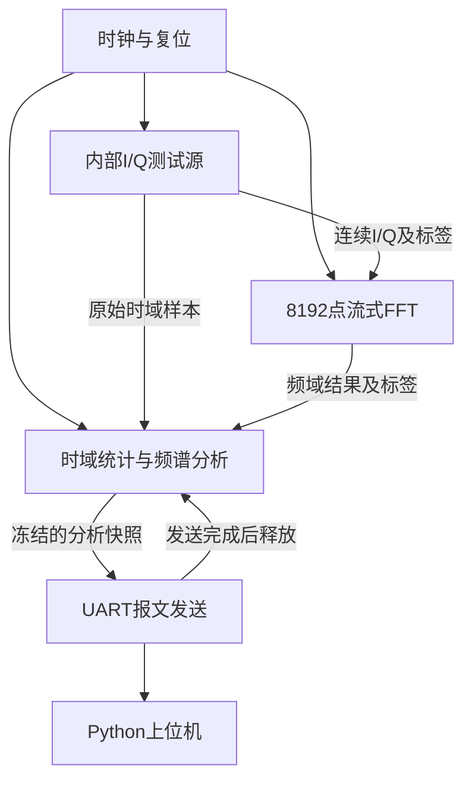

# FPGA数字I/Q时频域分析系统（Rev23）

基于 **EP4CE10F17C8（Cyclone IV E）** 的数字I/Q信号分析工程，包含内部测试信号源、8192点流式FFT、时域统计、频谱参数提取、UART输出和Python上位机。

本仓库面向复现验证与学习：通过已知输入、定点参考模型、自检测试平台和实际输出数据，理解各模块的计算过程与流水线时序，并复现功能仿真和板级展示。

> 本说明以Rev23工程和六模块ModelSim仿真包为基准。命令中的路径均相对于相应工程根目录；若Quartus工程、仿真包和上位机分别存放在不同子目录，请先进入对应目录。历史测试结果仅适用于当时的版本和测试覆盖范围，修改后的代码应重新运行相关测试。

## 1. 项目功能与参数

| 项目 | 参数或功能 |
|---|---|
| FPGA | EP4CE10F17C8 |
| 参考时钟 / 目标处理时钟 | 50 MHz / 200 MHz，由PLL转换 |
| 输入格式 | 每拍一对12位有符号I/Q，构成一个复数样本 |
| 目标复数样本处理速率 | 200 MSPS |
| FFT长度 | 8192点 |
| FFT结构 | 基2²、频率抽取型、单路径延迟反馈流式结构 |
| 帧观测窗口 | 8192 / 200 MHz = 40.96 μs |
| FFT频点间隔 | 200 MHz / 8192 = 24.4140625 kHz |
| 时域统计 | 峰值功率、总能量、活动点数、首尾跨度、最长连续活动段 |
| 频域统计 | 峰值频点、峰值附近连续的局部近似半功率带宽 |
| 时域快照 | 前256个连续I/Q样本 |
| 频谱快照 | 每32个频点取最大值，压缩为256列 |
| UART | 约115200 bit/s，8N1，1330字节报文，CRC16校验 |
| 上位机 | 波形、频谱、统计显示，以及CSV / JSON导出 |

本工程使用FPGA内部生成的数字测试样本，不包含外接ADC或射频前端。200 MSPS描述内部复数样本流的处理目标，不代表串口向电脑传送全部原始样本。

## 2. 系统架构



报告中的六个功能模块与源码对应如下。功率谱参数提取和系统控制主要共用一个`snapshot_analyzer`实体，六个功能模块并不对应六个独立RTL文件。

| 功能模块 | 主要源码 | 学习与验证重点 |
|---|---|---|
| 时钟与复位 | `pll_50_to_200.v`及顶层复位同步逻辑 | PLL配置、异步复位、三级同步释放 |
| 测试信号发生 | `iq_source.v` | I/Q生成、门控、样本与标签对齐 |
| 流式FFT | `fft8192_stream.v`、`sdf_butterfly.v`、`r22_twiddle.v`、相关RAM / ROM | 定点蝶形、旋转运算、反馈存储、连续吞吐 |
| 功率谱与参数提取 | `snapshot_analyzer.v`及平方、求和、峰值、编码、功率RAM模块 | 数值统计、边界条件、带宽搜索、快照数据 |
| 系统控制与性能监测 | `snapshot_analyzer.v`及顶层握手逻辑 | 选帧、分析计时、快照保持、释放与重新捕获 |
| 板级验证与输出 | `uart_packet.v`、顶层LED逻辑、`host/protocol.py`、`host/app.py` | 报文、CRC、UART时序、解析与显示 |

顶层模块为`spectrum_streaming_top`。FFT内部包含13个二点蝶形级和6个旋转因子模块；“单路径”表示数据流组织方式，不表示整个FFT仅使用一个蝶形。

## 3. 目录与依赖

以下是原工程与仿真包使用的主要目录。维护时应保留工程和脚本引用的相对路径。

| 路径或文件 | 内容 |
|---|---|
| `rtl/` | 最终RTL源码及工程所需的硬件模块 |
| `data/` | 正弦、旋转因子等初始化数据，包含`.hex` / `.mif` |
| `sim/` | 测试平台、定点参考模型、参考向量及仿真输出 |
| `modelsim/` | 六模块`.do`脚本、`common.tcl`及专项测试平台 |
| `scripts/` | 原Rev23工程的生成、算术检查和回归脚本 |
| `host/` | Python上位机、协议解析、依赖和启动脚本 |
| `.qpf` / `.qsf` / `.sdc` | Quartus工程、器件和引脚设置、时序约束 |
| `results/` | 仿真运行产生的日志、总结、串口包及波形记录 |
| `docs/` / `verification/` | 如有整理到这些目录，存放报告、插图和验证证据 |

复现所需的初始化数据、PLL / IP依赖和参考向量必须保留。部分回归会引用冻结的旧版参考RTL用于比较，这些文件属于测试依赖，不能仅因版本较旧而删除。

## 4. 环境准备

| 使用场景 | 需要的环境 |
|---|---|
| RTL功能前仿真 | ModelSim / Questa，支持本工程的Verilog和SystemVerilog测试平台 |
| Python模型与上位机 | Python 3，依赖以`host/requirements.txt`为准 |
| 综合、布局布线与烧录 | 支持Cyclone IV E及目标器件的Quartus软件和器件包 |
| 板级显示 | 对应FPGA板卡、下载器、兼容的UART接口与电脑 |
| 可选命令行回归 | Icarus Verilog，确保`iverilog`和`vvp`可从命令行调用 |
| 厂商存储器模型专项 | 配置可用的`altera_mf_ver`等所需仿真库 |

建议在Windows上将工程放在英文目录，例如`D:/FPGA/iq-spectrum`。下文ModelSim示例使用此路径；请替换为你的实际仿真根目录，该目录应包含`modelsim/common.tcl`。

复现时记录实际使用的Quartus、ModelSim / Questa、Python版本，以及仓库提交编号。已有资料未给出完整的软件版本组合，因此不指定一个未经验证的固定版本。

## 5. 快速开始：六模块功能前仿真

先确认六模块仿真包的RTL、初始化数据和参考向量已完整上传，且使用修正后的`modelsim/common.tcl`。

打开ModelSim，在Transcript中执行：

```tcl
quit -sim
cd D:/FPGA/iq-spectrum
do modelsim/01_clock_reset.do
```

时钟复位测试完成后，可一次执行完整回归：

```tcl
do modelsim/run_all.do
```

完整六模块仿真包的默认回归包含66个配置，全部通过时预期出现：

```text
ALL REQUESTED TESTS PASSED: ALL (66 cases)
```

脚本负责完成编译、加载、自检和结果记录。不能仅凭仿真运行到结束或波形窗口有数据就判断通过；应检查每个配置的开始、PASS和组结束记录，并排查编译错误、`$fatal`或数值不一致。

如果逐组运行，可使用：

```tcl
do modelsim/01_clock_reset.do
do modelsim/02_signal_source.do
do modelsim/03_streaming_fft.do
do modelsim/04_spectrum_parameters.do
do modelsim/05_control_monitor.do
do modelsim/06_board_output.do
```

| 分组 | 默认配置数 | 主要检查内容 |
|---|---:|---|
| M1 时钟与复位 | 1 | 时钟周期、三级复位释放、外部复位和失锁恢复 |
| M2 测试信号发生 | 5 | 逐点I/Q值、门控边界、标签对齐和帧边界 |
| M3 流式FFT | 35 | 蝶形、旋转器、Rev23算术及完整FFT结果 |
| M4 功率谱与参数提取 | 6 | 功率、峰值、能量、活动区间、RAM与带宽搜索 |
| M5 系统控制与性能监测 | 12 | 冷却参数、合法选帧、快照保持、重新捕获与恢复 |
| M6 顶层与输出 | 7 | 整链路、完整报文、UART及发送完成握手 |
| 合计 | 66 | 原完整回归的覆盖范围 |

默认配置数属于原完整仿真包，不能由本README介绍的三种展示信号推断测试总数。若维护者增删用例，应以当前脚本及本次日志为准，并同步更新说明。

### 单独观察突发模式

```tcl
source modelsim/common.tcl
six_test tb_source_math -gMODE=2
```

重点观察`I/Q`、`valid`、`index`、`frame`和`mode`。I/Q建议显示为有符号十进制，检查`index=1023/1024`和`5119/5120`附近的门控变化。

观察突发模式的整机UART链路：

```tcl
source modelsim/common.tcl
six_test tb_four_mode_system -gMODE=2 -gCPB=4
```

`tb_four_mode_system`是既有测试平台的文件名。此处通过`MODE=2`选择突发测试，并不需要修改测试平台名称。

### 仿真结果与原始波形

优先保留`results/transcript_ALL.log`；逐组运行则保留`transcript_M1.log`至`transcript_M6.log`。`summary.txt`可能被下一次运行覆盖，单独一份summary不能证明六组均通过。

用于核验的结果还包括`sim/rtl_fft.csv`、`metrics.csv`、`curves.csv`、`time.csv`，以及UART / 整机输出的HEX文件。具体生成文件以实际测试脚本为准。

若仓库包含`modelsim/export_report_vcd.do`且已有对应WLF记录，可在仿真根目录执行：

```tcl
quit -sim
do modelsim/export_report_vcd.do
```

导出的VCD用于提取真实信号转换时刻并制作报告波形图。已有图片用于展示，原始日志和输出数据用于进一步复核。

## 6. 测试信号与预期结果

本文以单音、双音和突发单音三类信号作为主要学习与展示用例。

| 模式 | 输入定义 | 验证目的 |
|---|---|---|
| 单音，`mode=0` | +25 MHz复数单音 | 频点定位、I/Q正交、幅度与能量统计 |
| 双音，`mode=1` | +25 MHz与半幅的−12.5 MHz分量叠加 | 多频分辨、正负频率映射、主峰选择 |
| 突发单音，`mode=2` | 第1024至5119点输出+25 MHz单音，其余为零 | 门控边界、活动点数、持续时间与整窗RMS |

Rev23历史整机仿真输出包的解析结果如下，供未修改的相同配置复现时核对：

| 模式 | 峰值频率 / MHz | 峰值幅度 / 码值 | RMS / 码值 | 活动点数 | 局部带宽 / bin | 分析耗时 / μs |
|---|---:|---:|---:|---:|---:|---:|
| 单音 | 25.000000 | 900.000 | 899.720 | 8192 | 1 | 287.300 |
| 双音 | 25.000000 | 1350.000 | 1005.801 | 8192 | 1 | 287.300 |
| 突发单音 | 25.000000 | 900.000 | 636.198 | 4096 | 1 | 287.300 |

双音的频谱应同时出现+25 MHz和−12.5 MHz分量，但“峰值频率”字段仅报告较强的主峰。突发活动长度为4096点，对应`4096 / 200 MHz = 20.480 μs`。

本README选用三种展示用例，不等同于已经删除原RTL或回归包中的其他历史测试配置。若修改信号源的自动切换范围，应同步修改上位机模式映射和参考向量，再运行回归。

## 7. 数据标签与结果含义

| 信号或指标 | 含义 |
|---|---|
| `index` | 帧内时域样本编号，范围0至8191 |
| `frame` | 8192点分析窗口的帧号，用于匹配时域输入与FFT输出 |
| `mode` | 当前测试模式标识 |
| `valid` | 本拍样本及其标签是否有效，零值样本也可以有效 |
| `bin` | FFT结果对应的自然频点编号 |
| `latency_cycles` | 从选定帧首个样本被接收至分析完成的计数 |
| `frames_skipped` | 相邻选定分析帧之间跳过的输入帧数量 |

FFT结果按位倒序出现，`bin`提供对应的自然频点标签，不能要求输出标签按0、1、2依次递增。完整FFT从开始有效输入后要求连续供数，子模块空拍测试不能证明整条FFT支持任意停顿。

定点FFT核对应使用`sim/model.py`等逐位参考模型，保持逐级缩放、系数量化、截断和回绕规则一致；浮点FFT后统一舍入不能直接替代逐位参考。

## 8. 编译、上板与上位机

### Quartus与板级运行

1. 打开最终`.qpf`工程，确认目标器件、引脚及板卡连接与实际硬件一致。
2. 确认PLL配置为50 MHz参考输入、200 MHz目标处理时钟，并保留相应初始化文件和IP依赖。
3. 执行完整编译，检查布局布线后的资源占用及TimeQuest时序报告。时序约束必须覆盖实际时钟和需要分析的路径。
4. 使用下载器及Quartus Programmer，将本次编译生成的`.sof`加载到FPGA。
5. 连接兼容的UART接口。外接USB转TTL时，FPGA UART TX连接模块RX，并连接共同地线，接口电平与板卡匹配。

仓库的内部测试源可以用于数字逻辑展示；这一步不等同于完成外接高速I/Q接口或ADC输入验证。

### Python上位机

进入包含最终上位机的`host`目录，在命令行运行：

```bat
python -m pip install -r requirements.txt
python app.py
```

Windows工程若保留批处理文件，也可首次运行`install_dependencies.bat`，之后运行`start_hardware.bat`。

选择实际COM端口，点击连接按钮，波特率使用115200。观察时域波形、频谱、统计值和CRC / 同步错误计数，并使用导出功能保存结果。

UART报文组成：

| 分区 | 字节数 |
|---|---:|
| 包头与统计字段 | 48 |
| 256对时域I/Q快照 | 1024 |
| 256列频谱快照 | 256 |
| CRC16 | 2 |
| 总计 | 1330 |

精确字段顺序、字节序、符号处理和CRC算法以`uart_packet.v`与`host/protocol.py`为准。修改协议时应同时更新发送端、解析端和相应测试。

## 9. 验证记录与适用范围

已有Rev23历史核验记录支持以下结论：

- 六模块共66个RTL功能测试配置通过。
- 七帧、共57344个FFT复数输出与定点参考逐点一致，频点标签和帧号匹配。
- 十组统计结果、2560列频谱和2560对I/Q快照匹配参考值。
- 五个完整UART包，每包1330字节，通过内容比较、CRC及重新编码核验。
- 已从六份VCD提取时钟复位、突发门控、FFT输出、参数提取、快照握手与UART时序插图。

复现者应保留本次产生的日志和数据，记录提交编号及工具版本。历史结论不能代替当前提交的运行结果，也不能将未覆盖的条件视为已经验证。

| 验证项目 | 资料支持的状态 |
|---|---|
| 六模块RTL功能前仿真 | 历史测试覆盖范围内通过 |
| 内部测试源的板级展示 | 已有运行反馈及部分截图，复现时需使用实际板卡核对 |
| 最终200 MHz物理时序 | 需以最终版本、正确约束下的布局布线后TimeQuest报告确认 |
| 真实UART分频专项 | 原流程提供独立测试，历史核验资料未包含其通过证据 |
| 厂商RAM / ROM模型专项 | 历史核验资料未包含完整专项运行证据 |
| 最大已验证宽带信号带宽 | 尚无对应验收记录 |

默认UART仿真采用加速参数。`CPB=4`、200 MHz时钟时，仿真比特宽度为20 ns，验证的是协议及握手逻辑，不代表真实115200 bit/s的位宽。真实分频专项可运行：

```tcl
do modelsim/run_real_baud.do
```

原Rev23工程还提供`scripts/run_vendor_revision23.do`用于厂商存储器模型专项；使用前需按该脚本和随附指南准备参考向量及厂商库。

## 10. 容易混淆的指标与现象

### 频率跨度、频点间隔和带宽

200 MSPS复数采样对应理论基带范围`[-100, +100) MHz`，总频率跨度为200 MHz。这个理论覆盖范围不是已经完成验收的最大信号占用带宽。

上位机的“局部半功率带宽”表示最强峰附近连续达到量化半功率阈值的区域。1个频点对应约0.024414 MHz；它既不是系统最大输入带宽，也不能直接视为理想单音的真实占用带宽。最终修正版上位机分别显示采样率、理论频率跨度、FFT点数、频点间隔及局部带宽。

### FFT吞吐量、分析耗时和串口刷新率

FFT持续吞吐量描述稳定运行时每拍处理多少样本；分析耗时还包含选定帧采集、频谱整理和带宽搜索，不包含后续UART传输或界面绘制。287.300 μs是上述三种整机测试配置的结果，不是所有输入下的固定值。独立分析器测试的输入时序不同，耗时也可能与整机不同。

UART只发送选定快照，不能按200 MSPS传送全部原始数据。`frames_skipped`较大说明两次快照跨过了很多输入帧，应结合帧号及协议核对，不能直接等同于串口丢包。

### 突发波形与活动检测

时域快照仅包含前256点，而突发从第1024点开始，因此该模式的时域快照全零、完整窗口的频谱有峰属于预期现象。

活动检测采用数字功率`I² + Q²`严格大于65536的门限。`valid=1`表示样本有效，不表示其幅度非零。活动时间、首尾跨度和最长连续活动时间描述窗口内的信号情况，不能自动解释为完整通信协议帧长。

### 仿真日志

- 若出现`Cannot change directory while a simulation is in progress`，先执行`quit -sim`，确认使用修正后的`common.tcl`，再切换目录。
- 初始化文件找不到时，检查当前根目录、`.hex` / `.mif`路径及工程依赖是否完整。
- 历史M5冷却测试存在未连接的非使用输出端口警告，应结合具体测试平台核对；不能据此忽略其他警告。
- `$finish`及相应仿真结束提示通常属于自检正常结束流程，应同时确认测试PASS记录。
- 不同FFT专项测试可能采用不同输入频率，应按各自测试平台及参考向量检查，不能要求所有测试都出现25 MHz主峰。

## 11. 可选：原Rev23命令行回归

若仓库同时保留原Rev23完整脚本和依赖，可在其工程根目录执行：

```bat
python -m pip install -r host/requirements.txt
python scripts/check_revision23_arithmetic.py
python scripts/test_revision23.py
python scripts/run_tests.py --core-only
```

第一条检查脚本进行Python整数算术验证；后两条会使用Icarus Verilog运行对应RTL测试。它们不能代替布局布线后的时序分析。若对应脚本或冻结参考数据未上传，请先补齐依赖。

## 12. 学习与修改建议

建议按“数据格式与标签 → 测试信号源 → 功率统计 → 蝶形与旋转器 → 完整FFT → 分析器控制 → UART及上位机”的顺序阅读源码，并对照各模块自检与波形。

修改位宽、FFT长度、门限、流水级数或报文格式时，应先更新参考模型及相应测试，再检查数据、有效信号和标签是否同拍对齐。修改后若要上板，应重新编译并检查最终时序。

提交问题或复现结果时，请提供：仓库提交编号、工具版本、执行的脚本、测试参数、预期和实际结果，以及相关日志或关键波形。新测试可通过Issue或Pull Request提出；源码访问请联系仓库所有者。

